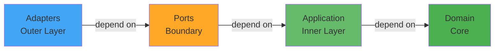
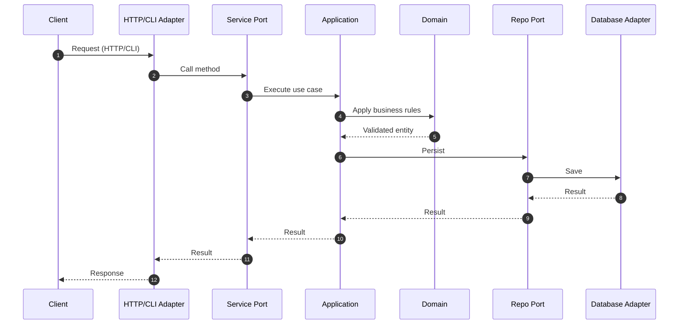
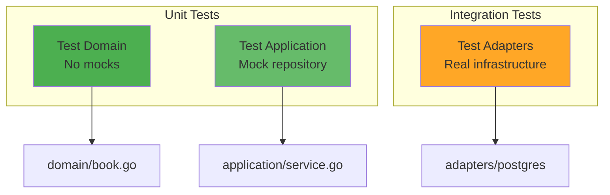
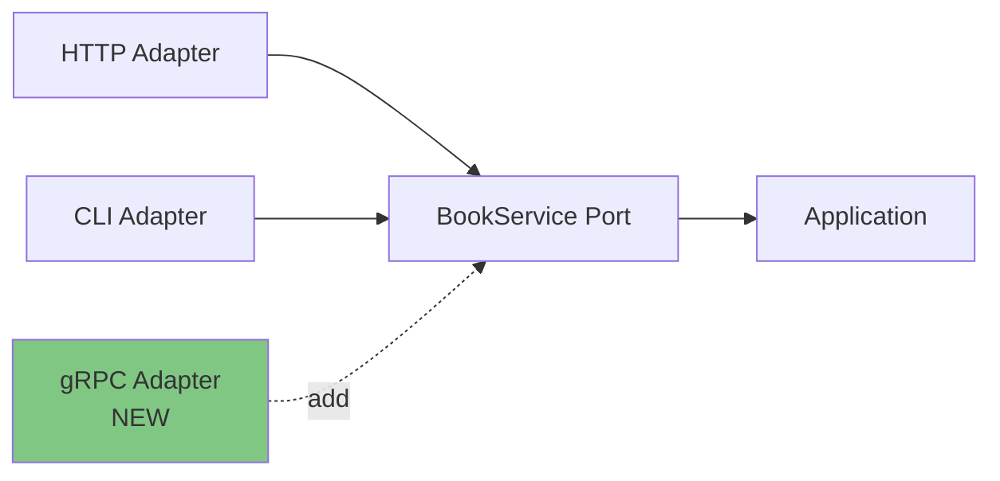
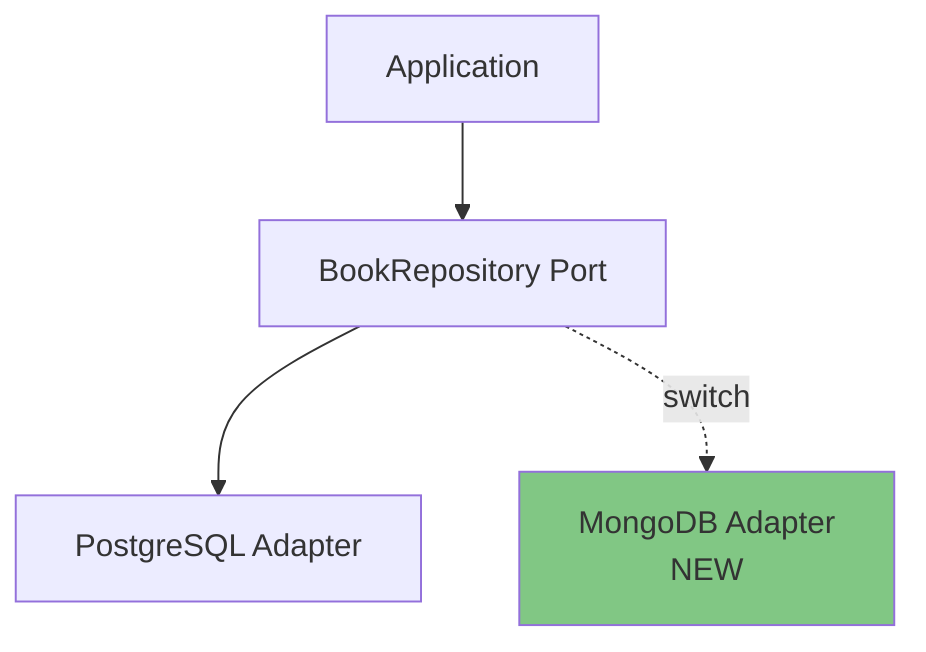
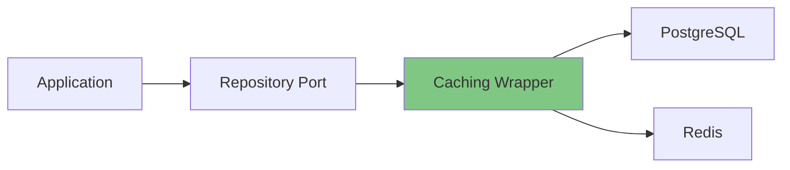

# Architecture Deep Dive

Advanced concepts and patterns for hexagonal architecture implementation.

## The Dependency Rule



**Rule**: Dependencies always point INWARD. The domain has zero dependencies.

## Layer Responsibilities

### Domain Layer
**What**: Pure business entities and validation  
**Dependencies**: None  
**Example**:
```go
func NewBook(title, author, isbn string) (*Book, error) {
    if title == "" {
        return nil, ErrInvalidTitle
    }
    if !isValidISBN(isbn) {
        return nil, ErrInvalidISBN
    }
    return &Book{ID: uuid.New().String(), Title: title, ...}, nil
}
```

### Ports Layer
**What**: Interface contracts  
**Dependencies**: Domain only  
**Two types**:

**Inbound (Driving)**: What app CAN DO
```go
type BookService interface {
    CreateBook(title, author, isbn string) (*Book, error)
}
```

**Outbound (Driven)**: What app NEEDS
```go
type BookRepository interface {
    Save(book *Book) error
}
```

### Application Layer
**What**: Use case orchestration  
**Dependencies**: Domain + Ports  
**Example**:
```go
func (s *bookService) CreateBook(title, author, isbn string) (*Book, error) {
    book, err := domain.NewBook(title, author, isbn) // Domain creates
    if err != nil {
        return nil, err
    }
    return book, s.repo.Save(book) // Port saves
}
```

### Adapter Layer
**What**: Infrastructure implementation  
**Dependencies**: Ports + Application  
**Example**:
```go
func (r *postgresRepo) Save(book *Book) error {
    _, err := r.db.Exec("INSERT INTO books...", book.ID, book.Title, ...)
    return err
}
```

## Request Flow



**Key Points**:
1. Client never talks directly to business logic
2. Adapters translate between external format and domain
3. Business logic only sees domain objects
4. Infrastructure details isolated in adapters

## Testing Strategy



**Domain Tests** - Pure logic, no infrastructure:
```go
func TestBookValidation(t *testing.T) {
    _, err := domain.NewBook("", "Author", "ISBN")
    assert.Error(t, err, "empty title should fail")
}
```

**Application Tests** - Mock outbound ports:
```go
type MockRepo struct {
    SaveCalled bool
}

func (m *MockRepo) Save(*Book) error {
    m.SaveCalled = true
    return nil
}

func TestCreateBook(t *testing.T) {
    repo := &MockRepo{}
    svc := NewBookService(repo)
    _, _ = svc.CreateBook("Title", "Author", "ISBN")
    assert.True(t, repo.SaveCalled)
}
```

**Adapter Tests** - Real infrastructure:
```go
func TestPostgresRepository(t *testing.T) {
    db := setupTestDatabase()
    repo := postgres.NewBookRepository(db)
    
    book := &domain.Book{...}
    err := repo.Save(book)
    assert.NoError(t, err)
    
    found, _ := repo.FindByID(book.ID)
    assert.Equal(t, book.Title, found.Title)
}
```

## Extending the System

### Adding a New Interface (gRPC)



**Steps**:
1. Create `adapters/grpc/handler.go`
2. Implement gRPC service using `BookService` port
3. Wire in `main.go`

**Code**:
```go
type BookGRPCService struct {
    service ports.BookService // same interface!
}

func (g *BookGRPCService) CreateBook(ctx context.Context, req *pb.CreateBookRequest) (*pb.Book, error) {
    book, err := g.service.CreateBook(req.Title, req.Author, req.ISBN)
    return toProto(book), err
}
```

### Switching Databases (MongoDB)



**Steps**:
1. Create `adapters/mongodb/repository.go`
2. Implement `BookRepository` interface
3. Change one line in `main.go`

**Code**:
```go
// adapters/mongodb/repository.go
type mongoRepo struct {
    collection *mongo.Collection
}

func (r *mongoRepo) Save(book *domain.Book) error {
    _, err := r.collection.InsertOne(context.Background(), book)
    return err
}

// main.go - only this changes:
// repo := postgres.NewBookRepository(db)
repo := mongodb.NewBookRepository(client)
```

### Adding Caching



**Decorator pattern**:
```go
type CachedRepository struct {
    repo  ports.BookRepository
    cache Cache
}

func (c *CachedRepository) FindByID(id string) (*domain.Book, error) {
    if book := c.cache.Get(id); book != nil {
        return book, nil
    }
    
    book, err := c.repo.FindByID(id)
    if err == nil {
        c.cache.Set(id, book)
    }
    return book, err
}

// In main.go:
baseRepo := postgres.NewBookRepository(db)
cachedRepo := NewCachedRepository(baseRepo, redisCache)
service := application.NewBookService(cachedRepo)
```

## Common Mistakes

### ❌ Domain importing infrastructure
```go
// domain/book.go
import "database/sql" // WRONG!
```

### ❌ Adapter-to-adapter calls
```go
// adapters/http/handler.go
import "myapp/adapters/postgres" // WRONG!

func (h *Handler) Create() {
    repo := postgres.NewRepo() // WRONG!
}
```

### ❌ Business logic in adapters
```go
// adapters/http/handler.go
func (h *Handler) CreateBook(w http.ResponseWriter, r *http.Request) {
    if req.Title == "" { // WRONG! This is business logic
        return
    }
}
```

### ✅ Correct approach
```go
// domain/book.go
func NewBook(title string) (*Book, error) {
    if title == "" { // Business logic in domain
        return nil, ErrInvalidTitle
    }
    return &Book{Title: title}, nil
}

// adapters/http/handler.go
func (h *Handler) CreateBook(w http.ResponseWriter, r *http.Request) {
    book, err := h.service.CreateBook(req.Title, ...) // Delegate to service
    if err != nil {
        respondWithError(w, err) // Adapter handles HTTP concerns
    }
}
```

## Real-World Benefits

**Before**: Tight coupling
```go
type BookController struct {
    db *sql.DB // Directly coupled to database
}

func (c *BookController) HandleCreate(w http.ResponseWriter, r *http.Request) {
    // Parse HTTP
    var req CreateRequest
    json.NewDecoder(r.Body).Decode(&req)
    
    // Business logic mixed with infrastructure
    if req.Title == "" {
        http.Error(w, "invalid", 400)
        return
    }
    
    // Direct SQL
    _, err := c.db.Exec("INSERT INTO books...", req.Title, req.Author)
    if err != nil {
        http.Error(w, err.Error(), 500)
        return
    }
    
    // Return HTTP response
    w.WriteHeader(201)
}
```

**Problems**:
- Can't test business logic without HTTP and database
- Can't reuse logic for CLI or gRPC
- Can't swap database without rewriting controller
- Business rules scattered across controllers

**After**: Hexagonal architecture
```go
// Domain: Pure business logic
func NewBook(title, author, isbn string) (*Book, error) {
    if title == "" {
        return nil, ErrInvalidTitle
    }
    return &Book{...}, nil
}

// Application: Use case
func (s *service) CreateBook(title, author, isbn string) (*Book, error) {
    book, err := domain.NewBook(title, author, isbn)
    if err != nil {
        return nil, err
    }
    return book, s.repo.Save(book)
}

// HTTP Adapter: Infrastructure
func (h *handler) CreateBook(w http.ResponseWriter, r *http.Request) {
    var req CreateRequest
    json.NewDecoder(r.Body).Decode(&req)
    
    book, err := h.service.CreateBook(req.Title, req.Author, req.ISBN)
    if err != nil {
        respondWithError(w, 400, err.Error())
        return
    }
    
    respondWithJSON(w, 201, book)
}
```

**Benefits**:
- Business logic testable in pure Go
- Same logic works for HTTP, CLI, gRPC
- Swap database by changing one line
- Business rules centralized in domain

## Summary

**Hexagonal Architecture** separates **what** your system does (business logic) from **how** it does it (infrastructure).

**Key principles**:
1. Dependencies point inward
2. Domain has zero dependencies
3. Ports define contracts
4. Adapters implement details
5. Wire everything in main

**Result**: Flexible, testable, maintainable systems that adapt to changing requirements.
