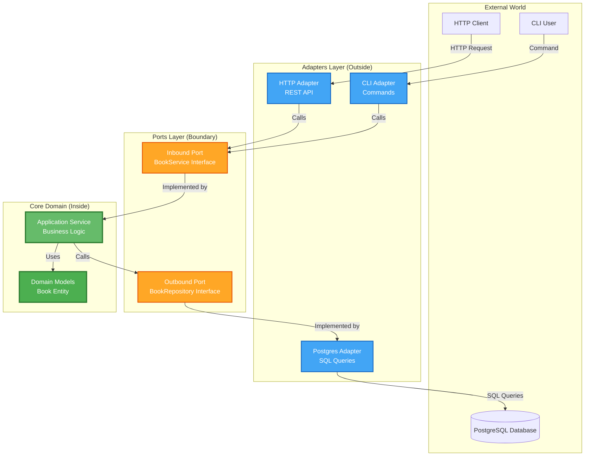
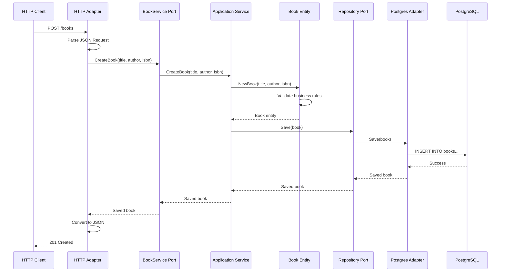
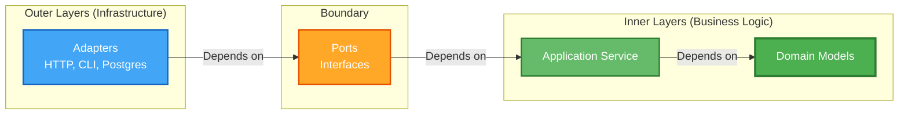

# Hexagonal Architecture (Ports & Adapters) - Complete Go Example

This is a complete demonstration of **Hexagonal Architecture** (also known as **Ports & Adapters**) using Go and PostgreSQL.

## Table of Contents
- [What is Hexagonal Architecture?](#what-is-hexagonal-architecture)
- [Core Concepts](#core-concepts)
- [Architecture Diagrams](#architecture-diagrams)
- [Project Structure](#project-structure)
- [The Book Library Example](#the-book-library-example)
- [Running the Application](#running-the-application)

---

## What is Hexagonal Architecture?

**Hexagonal Architecture** is a software design pattern created by Alistair Cockburn that aims to create loosely coupled application components that can be easily connected to their software environment through **ports** and **adapters**.

### Key Benefits:
- **Technology Independence**: Business logic doesn't depend on frameworks, databases, or UI
- **Testability**: Core logic can be tested without external dependencies
- **Flexibility**: Easy to swap implementations (e.g., switch from PostgreSQL to MongoDB)
- **Maintainability**: Clear separation of concerns

---

## Core Concepts

### 1. The Domain (Center of the Hexagon)
The **domain** contains your core business logic and rules. It has **zero dependencies** on external frameworks or infrastructure.

**In this project**: `internal/domain/book.go`
- Defines the `Book` entity
- Contains business validation logic
- Pure Go structs and functions

### 2. Ports (Interfaces)
**Ports** are interfaces that define how the outside world interacts with your application.

There are two types:

#### **Inbound Ports (Driving Ports)**
- Define what your application **can do** (use cases)
- Called BY external actors (HTTP handlers, CLI, etc.)
- **In this project**: `internal/ports/service.go`
  - `BookService` interface defines operations like `CreateBook`, `GetBook`, etc.

#### **Outbound Ports (Driven Ports)**
- Define what your application **needs** from external systems
- Called BY your application to interact with databases, APIs, etc.
- **In this project**: `internal/ports/repository.go`
  - `BookRepository` interface defines data persistence operations

### 3. Adapters (Implementations)
**Adapters** are concrete implementations that connect the outside world to your ports.

#### **Inbound Adapters (Driving Adapters)**
- Implement the entry points to your application
- Convert external requests into domain operations
- **In this project**:
  - `internal/adapters/http/` - HTTP REST API adapter
  - `internal/adapters/cli/` - Command-line interface adapter

#### **Outbound Adapters (Driven Adapters)**
- Implement the outbound ports
- Handle external system interactions (database, external APIs, etc.)
- **In this project**:
  - `internal/adapters/postgres/` - PostgreSQL database adapter

### 4. Application Layer
The **application layer** contains the actual implementation of your use cases. It orchestrates the domain objects and calls outbound ports.

**In this project**: `internal/application/book_service.go`

---

## Architecture Diagrams

### High-Level Hexagonal Architecture



### Data Flow: Creating a Book via HTTP



### Dependency Direction Rule



**Key Rule**: Dependencies point **INWARD**. The domain has zero dependencies. Adapters depend on ports, never the other way around.

---

## Project Structure

```
hexagonal-demo/
├── cmd/
│   ├── api/                    # HTTP server entry point
│   │   └── main.go
│   └── cli/                    # CLI entry point
│       └── main.go
├── internal/
│   ├── domain/                 # CORE: Business entities and logic
│   │   └── book.go            # Book entity with validation
│   ├── ports/                  # PORTS: Interfaces
│   │   ├── service.go         # Inbound port (BookService)
│   │   └── repository.go      # Outbound port (BookRepository)
│   ├── application/            # APPLICATION: Use case implementations
│   │   └── book_service.go    # BookService implementation
│   └── adapters/               # ADAPTERS: Concrete implementations
│       ├── http/              # Inbound adapter: HTTP REST API
│       │   └── handler.go
│       ├── cli/               # Inbound adapter: CLI commands
│       │   └── commands.go
│       └── postgres/          # Outbound adapter: PostgreSQL
│           └── book_repository.go
├── migrations/
│   └── 001_create_books_table.sql
├── go.mod
└── README.md
```

### Layer Breakdown:

| Layer | Directory | Purpose | Dependencies |
|-------|-----------|---------|--------------|
| **Domain** | `internal/domain/` | Business entities, rules, validation | NONE |
| **Ports** | `internal/ports/` | Interface definitions | Domain only |
| **Application** | `internal/application/` | Use case orchestration | Domain, Ports |
| **Adapters** | `internal/adapters/` | External system integration | Ports, Application |
| **Entry Points** | `cmd/` | Application initialization | Everything |

---

## The Book Library Example

### Domain Layer

**Book Entity** (`internal/domain/book.go`):
- Represents a book in our system
- Contains validation logic (e.g., ISBN format, required fields)
- **No infrastructure dependencies**

### Ports Layer

**Inbound Port** - `BookService` interface:
```go
type BookService interface {
    CreateBook(title, author, isbn string) (*domain.Book, error)
    GetBook(id string) (*domain.Book, error)
    ListBooks() ([]*domain.Book, error)
    UpdateBook(id, title, author, isbn string) (*domain.Book, error)
    DeleteBook(id string) error
}
```

**Outbound Port** - `BookRepository` interface:
```go
type BookRepository interface {
    Save(book *domain.Book) error
    FindByID(id string) (*domain.Book, error)
    FindAll() ([]*domain.Book, error)
    Update(book *domain.Book) error
    Delete(id string) error
}
```

### Application Layer

**BookService Implementation**:
- Implements the `BookService` port
- Orchestrates business logic
- Uses the `BookRepository` port (doesn't know it's PostgreSQL)

### Adapters

**HTTP Adapter** (`internal/adapters/http/`):
- Provides REST API endpoints
- Converts HTTP requests to service calls
- Returns JSON responses

**PostgreSQL Adapter** (`internal/adapters/postgres/`):
- Implements `BookRepository` interface
- Handles SQL queries
- Maps between domain models and database rows

**CLI Adapter** (`internal/adapters/cli/`):
- Provides command-line interface
- Parses CLI arguments
- Calls service methods

---

## Running the Application

### 1. Setup PostgreSQL Database

```bash
# Database will be created automatically, but you can create it manually:
psql -U dhev -h localhost
CREATE DATABASE bookstore;
```

### 2. Run Migrations

```bash
psql -U dhev -h localhost -d bookstore -f migrations/001_create_books_table.sql
```

### 3. Run the HTTP API Server

```bash
cd cmd/api
go run main.go
```

The API will be available at `http://localhost:8080`

### 4. Test the API

```bash
# Create a book
curl -X POST http://localhost:8080/books \
  -H "Content-Type: application/json" \
  -d '{"title":"Clean Architecture","author":"Robert C. Martin","isbn":"978-0134494166"}'

# Get all books
curl http://localhost:8080/books

# Get a specific book
curl http://localhost:8080/books/{id}

# Update a book
curl -X PUT http://localhost:8080/books/{id} \
  -H "Content-Type: application/json" \
  -d '{"title":"Updated Title","author":"Robert C. Martin","isbn":"978-0134494166"}'

# Delete a book
curl -X DELETE http://localhost:8080/books/{id}
```

### 5. Use the CLI

```bash
cd cmd/cli
go run main.go create "Clean Code" "Robert C. Martin" "978-0132350884"
go run main.go list
go run main.go get {id}
```

---

## Key Takeaways

### Why This Architecture?

1. **Testability**: You can test business logic without a database or HTTP server
2. **Flexibility**: Easy to add new adapters (e.g., gRPC, GraphQL, MongoDB)
3. **Independence**: Business logic doesn't care about infrastructure details
4. **Maintainability**: Clear boundaries make the codebase easier to understand

### The Hexagonal Mindset

- **Inside (Domain)**: What the business does
- **Ports**: How we talk to the business logic
- **Adapters**: The specific technologies we use to talk

### Common Mistakes to Avoid

1. ❌ Domain entities importing database packages
2. ❌ Business logic in HTTP handlers
3. ❌ Direct adapter-to-adapter communication
4. ✅ All dependencies point inward
5. ✅ Ports are interfaces, adapters are implementations
6. ✅ Domain is pure business logic

---

## Next Steps

To extend this example, you could add:
- Authentication adapter
- Caching adapter (Redis)
- Message queue adapter (RabbitMQ, Kafka)
- gRPC adapter
- GraphQL adapter
- Additional domain entities (Authors, Publishers)
- Event sourcing

Each new adapter plugs into existing ports without touching the core business logic!
