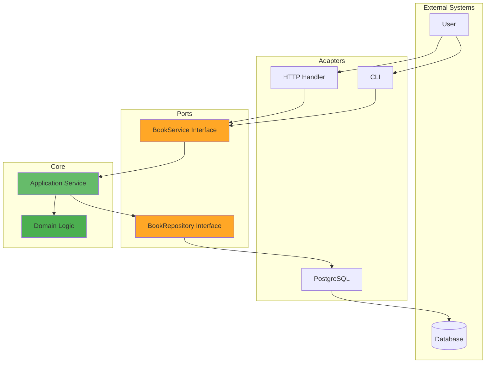
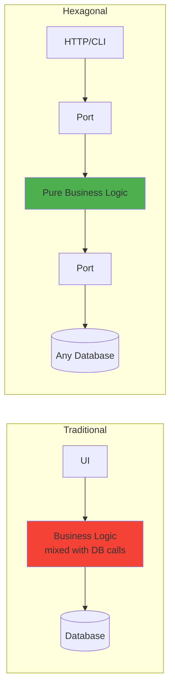
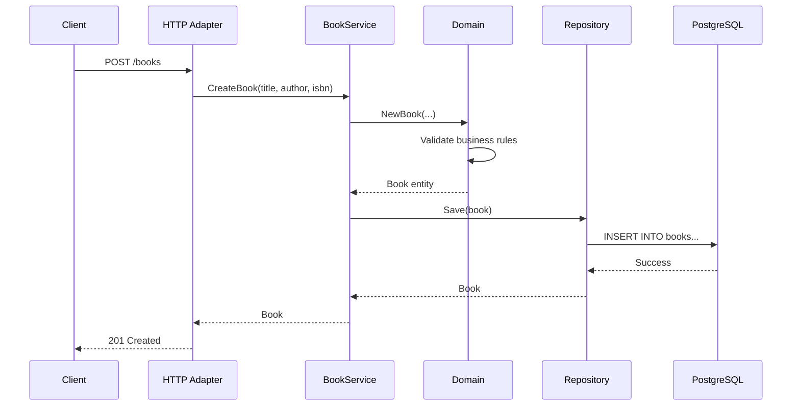

# Hexagonal Architecture in Go

A production-ready example of Hexagonal Architecture (Ports & Adapters pattern) with Go and PostgreSQL.

## Quick Start

```bash
# 1. Setup database
psql -U postgres -h localhost -c "CREATE DATABASE bookstore;"
psql -U postgres -h localhost -d bookstore -f migrations/001_create_books_table.sql

# 2. Build
go build -o bin/api cmd/api/main.go
go build -o bin/cli cmd/cli/main.go

# 3. Run
./bin/cli list
# or
./bin/api  # HTTP server on :8080
```

## What is Hexagonal Architecture?

Business logic at the center, completely independent of external systems. Infrastructure adapts to your core, not the other way around.



### The Key Insight



**Left**: Business logic knows about database details  
**Right**: Business logic knows nothing about infrastructure

## Project Structure

```
internal/
├── domain/          # Business entities & rules (zero dependencies)
├── ports/           # Interfaces defining contracts
├── application/     # Use case implementations
└── adapters/        # Infrastructure implementations
    ├── http/       # REST API (inbound)
    ├── cli/        # Command-line (inbound)
    └── postgres/   # Database (outbound)
```

## Core Concepts

### 1. Ports (Interfaces)

**Inbound Ports** - What your app can DO:
```go
type BookService interface {
    CreateBook(title, author, isbn string) (*domain.Book, error)
    GetBook(id string) (*domain.Book, error)
    // ...
}
```

**Outbound Ports** - What your app NEEDS:
```go
type BookRepository interface {
    Save(book *domain.Book) error
    FindByID(id string) (*domain.Book, error)
    // ...
}
```

### 2. Adapters (Implementations)

**Inbound Adapters** call your application:
- HTTP handler converts REST requests → service calls
- CLI converts commands → service calls

**Outbound Adapters** are called by your application:
- PostgreSQL adapter converts domain models → SQL queries

### 3. Dependency Injection (main.go)

```go
// Create outbound adapter
repo := postgres.NewBookRepository(db)

// Inject into application service
service := application.NewBookService(repo)

// Inject into inbound adapters
httpHandler := http.NewBookHandler(service)
cliHandler := cli.NewBookCLI(service)
```

## Flow Example

Creating a book via HTTP:



**Key**: Business validation happens in Domain, infrastructure details in adapters.

## Benefits

### Before (Layered)
```go
// Business logic mixed with infrastructure
func CreateBook(db *sql.DB, title string) error {
    // validation here
    _, err := db.Exec("INSERT INTO books...") // coupled to PostgreSQL
    return err
}
```

### After (Hexagonal)
```go
// Domain: Pure business logic
func NewBook(title, author, isbn string) (*Book, error) {
    if title == "" {
        return nil, ErrInvalidTitle
    }
    return &Book{...}, nil
}

// Application: Orchestration
func (s *service) CreateBook(...) (*Book, error) {
    book, err := domain.NewBook(...)
    return book, s.repo.Save(book) // repo is an interface
}
```

**Result**: Change database? Write new adapter. Business logic untouched.

## Usage

### CLI
```bash
./bin/cli create "Clean Code" "Robert Martin" "978-0132350884"
./bin/cli list
./bin/cli get {id}
./bin/cli update {id} "New Title" "Author" "ISBN"
./bin/cli delete {id}
```

### HTTP API
```bash
# Create
curl -X POST http://localhost:8080/books \
  -H "Content-Type: application/json" \
  -d '{"title":"Clean Code","author":"Robert Martin","isbn":"978-0132350884"}'

# List
curl http://localhost:8080/books

# Get
curl http://localhost:8080/books/{id}

# Update
curl -X PUT http://localhost:8080/books/{id} \
  -H "Content-Type: application/json" \
  -d '{"title":"Updated","author":"Author","isbn":"ISBN"}'

# Delete
curl -X DELETE http://localhost:8080/books/{id}
```

## Configuration

Environment variables (all optional):

```bash
export DB_HOST=localhost      # default
export DB_PORT=5432          # default
export DB_USER=postgres      # default
export DB_PASSWORD=postgres  # default
export DB_NAME=bookstore     # default
export SERVER_PORT=8080      # default
```

## Testing Strategy

```go
// Domain: No mocks needed
func TestNewBook(t *testing.T) {
    book, err := domain.NewBook("Title", "Author", "978-0132350884")
    assert.NoError(t, err)
}

// Application: Mock repository interface
func TestCreateBook(t *testing.T) {
    mockRepo := &MockRepository{}
    service := application.NewBookService(mockRepo)
    book, _ := service.CreateBook("Title", "Author", "ISBN")
    assert.Equal(t, 1, mockRepo.SaveCalls)
}

// Adapter: Real database
func TestPostgresAdapter(t *testing.T) {
    db := setupTestDB()
    repo := postgres.NewBookRepository(db)
    err := repo.Save(book)
    assert.NoError(t, err)
}
```

## Why This Matters

**Scenario**: Switch from PostgreSQL to MongoDB

**Required changes**:
1. Create `adapters/mongodb/book_repository.go`
2. Implement `BookRepository` interface
3. In `main.go`: Change one line

**Zero changes to**:
- Domain logic
- Application service
- HTTP adapter
- CLI adapter

---

**Further reading**:
- [ARCHITECTURE.md](ARCHITECTURE.md) - Deep dive into the pattern
- [QUICKSTART.md](QUICKSTART.md) - Detailed setup and usage

Built to demonstrate clean, testable architecture in Go.
